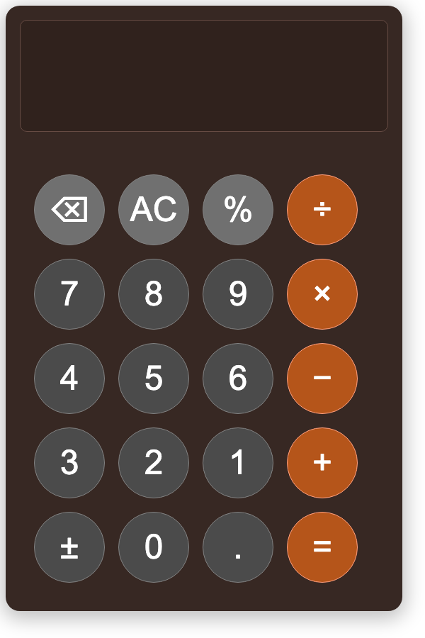

# Calculator

A simple calculator built with plain HTML, CSS and JavaScript, with no frameworks or dependencies.



## Features

- The four basic operations: addition (+), subtraction (−), multiplication (×) and division (÷)
- Decimal numbers (the decimal button is disabled once the number already has a point)
- **AC** clears the display
- **⌫** deletes the last entered digit
- The display shows both the calculation and the current number

## Getting started

No installation or build step is needed.

1. Clone the repo:
   ```bash
   git clone <repo-url>
   cd calculator
   ```
2. Open `index.html` in a browser.

You can also run a local server, for example with the VS Code Live Server extension or:

```bash
python3 -m http.server
```

then open `http://localhost:8000`.

## Project structure

```
calculator/
├── index.html   # Structure: display and buttons
├── style.css    # Styling: layout, colors and button styles
├── script.js    # Logic: button clicks, calculations and display
└── images/      # Screenshot for the README
```

## How it works

Each button has a `data-value` attribute. A shared click handler in `script.js` reads the value and decides what to do based on the button's class:

- `.number`: digits and the decimal point are appended to the current number
- `.operand`: the operation is stored and the first number (`a`) moves up to the top line

When you press **=**, the `operate()` function calculates the result from `a`, `b` and the chosen operation.

## Limitations

- The **%** and **±** buttons are not implemented yet
- A calculation handles two numbers at a time (e.g. `3 + 4`), not longer chains like `3 + 4 × 2`
- Division by zero returns `Infinity`
